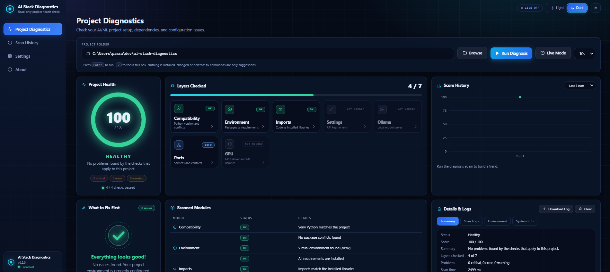
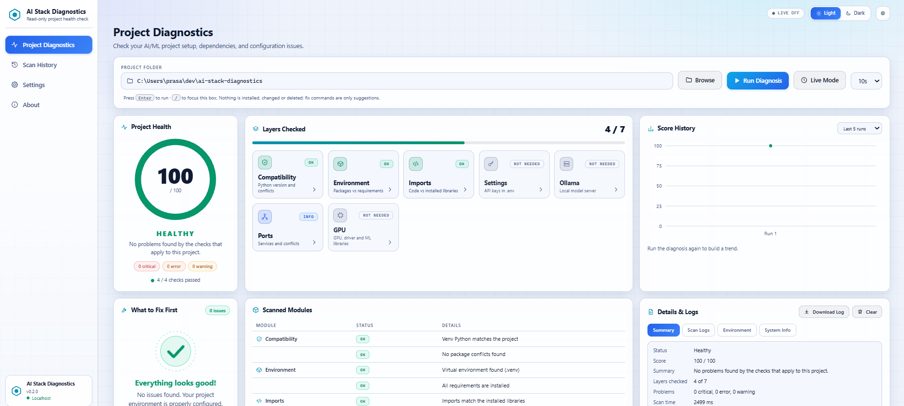

# ai-stack-diagnostics

[](https://github.com/PrasannaBalaji29/ai-stack-diagnostics/actions/workflows/ci.yml)
[](https://github.com/PrasannaBalaji29/ai-stack-diagnostics/actions/workflows/codeql.yml)
[](LICENSE)


**Why won't this AI project run, and what do I fix first?**
Point it at a project folder. It reads the project (never changes it), runs only the checks that apply, and gives **one prioritized report**: a health score and a numbered list of fixes.

Use it three ways: as an **MCP server** inside Claude Desktop, through a **local dashboard** in your browser, or with a **terminal command**. All of them run only on your computer.

## The dashboard

Pick a project folder (the **Browse** button opens a normal folder window, or paste the path), press **Run Diagnosis**, and get the health score, the layers that were checked and what to fix first. It has a dark and a light theme.

<p align="center">
  
</p>
<p align="center">
  
</p>

## What it checks
| Layer | Examples | Tool |
|---|---|---|
| Python | venv Python vs the project's `requires-python`; packages that do not support your Python | `check_compat` |
| Libraries | missing or wrong-version packages; package conflicts | `check_python_env`, `check_compat` |
| Code vs environment | libraries imported in code but not installed or not listed; standard-library modules removed in new Python (`distutils`, `imp`, `cgi`...) | `check_imports` |
| Settings | `.env` missing or keys left empty (key names only, never values) | `check_env_and_keys` |
| Services | local Ollama and its models; ports already in use | `check_ollama`, `check_ports` |
| Hardware | NVIDIA driver vs PyTorch, TensorFlow, JAX, ONNX Runtime and CuPy builds; mixed CUDA libraries; GPU memory nearly full; AMD, Intel and Apple graphics (which library build can use them) | `check_gpu` |
| Errors | paste an error or traceback: likely cause and exact fix in plain words (about 45 known errors); warns if the text contains a secret key | `explain_error` |
| Everything | scan, run the needed checks, one report | **`diagnose`** |

See [ROADMAP.md](ROADMAP.md) for what is next.

## Works on
Windows 10/11, macOS and Linux, with Python 3.10 to 3.13. The automated tests run on every change on Ubuntu, Windows and macOS. The checks that depend on your hardware (GPU, ports, Ollama) adapt to what the machine has: NVIDIA is compared exactly, AMD, Intel and Apple graphics get plain guidance, and a machine with no GPU is simply reported as CPU only.

## Install
**Windows (PowerShell)**
```powershell
git clone https://github.com/PrasannaBalaji29/ai-stack-diagnostics.git
cd ai-stack-diagnostics
python -m venv .venv
.\.venv\Scripts\Activate.ps1
pip install -r requirements.txt
```
**macOS and Linux**
```bash
git clone https://github.com/PrasannaBalaji29/ai-stack-diagnostics.git
cd ai-stack-diagnostics
python3 -m venv .venv
source .venv/bin/activate
pip install -r requirements.txt
```

## Use it from the terminal
No Claude Desktop needed:
```
python -m diagnostics                    # check the folder you are in
python -m diagnostics /path/to/project   # check another folder
python -m diagnostics --json             # the report as JSON
python -m diagnostics --fail-on warning  # exit code 1 if a warning or worse is found (handy in CI)
python -m diagnostics --explain          # paste an error message, get the cause and the fix
```
Exit codes: `0` fine, `1` problems at or above `--fail-on` (default: error), `2` bad input. Colors only appear in a real terminal and never when `NO_COLOR` is set.

## Use it in Claude Desktop
Open `claude_desktop_config.json` (Windows: `%APPDATA%\Claude\`, macOS: `~/Library/Application Support/Claude/`), add this with your own paths, then fully quit and reopen Claude Desktop.

Windows:
```json
{
  "mcpServers": {
    "ai-stack-diagnostics": {
      "command": "C:\\path\\to\\ai-stack-diagnostics\\.venv\\Scripts\\python.exe",
      "args": ["C:\\path\\to\\ai-stack-diagnostics\\server.py"]
    }
  }
}
```
macOS (on Linux use any MCP client that can start a local stdio server, with the same two lines):
```json
{
  "mcpServers": {
    "ai-stack-diagnostics": {
      "command": "/path/to/ai-stack-diagnostics/.venv/bin/python",
      "args": ["/path/to/ai-stack-diagnostics/server.py"]
    }
  }
}
```
In a new chat, click **+**, choose **Diagnose my project**, and enter a folder path. Or ask: *"Use the diagnose tool from ai-stack-diagnostics on /path/to/my-project"*. Paste an error message and ask what it means to use `explain_error`.

## Use the dashboard
```
python -m dashboard /path/to/my-project
```
A page opens at `http://127.0.0.1:8765` (your computer only; if that port is busy the next free one is used and printed):
- **Project Health:** an animated score gauge and a status (Healthy / Needs attention / Broken).
- **Layers Checked:** one tile per layer (Python, libraries, imports, keys, Ollama, ports, GPU) that fills in live while the scan runs. Click a tile to read its findings.
- **What to Fix First:** a numbered list, most important first, with **Copy** buttons for the suggested commands.
- **Details & Logs:** a real log of each step with timings, an Environment tab, a System Info tab, and **Download Log**.
- **Browse** opens your computer's own folder window (it uses Python's built-in tkinter; on Ubuntu or Debian install it with `sudo apt install python3-tk`; if it is missing, paste the path instead). **Live Mode** re-scans every 5/10/30 seconds and tells you what got fixed or newly broke.
- **Scan History**, **Settings** (Dark / Light / System theme, intervals, animations) and **About**. History and settings stay in your browser only.
- Keyboard friendly and checked with an automated accessibility audit (axe-core, no violations in light or dark mode).

## Safe by design
Read-only; only the folder you choose; secrets never returned; the dashboard is locked down against other websites. Details, tests and honest limits: [SECURITY.md](SECURITY.md).

## Development
```powershell
python -m pytest -q          # all tests (more than 700)
ruff check . ; mypy diagnostics server.py dashboard
bandit -c pyproject.toml -r diagnostics server.py dashboard -ll -ii
pip-audit -r requirements.txt
npm ci --prefix tests/frontend ; python tests/frontend/run_e2e.py   # browser-engine test (needs Node.js)
```

## Contributing
See [CONTRIBUTING.md](CONTRIBUTING.md). Bug reports and new known-error patterns are welcome; please read the [Code of Conduct](CODE_OF_CONDUCT.md) and the [security policy](SECURITY.md).

## License

MIT. See [LICENSE](LICENSE). Copyright (c) 2026 Prasanna Balaji L.
